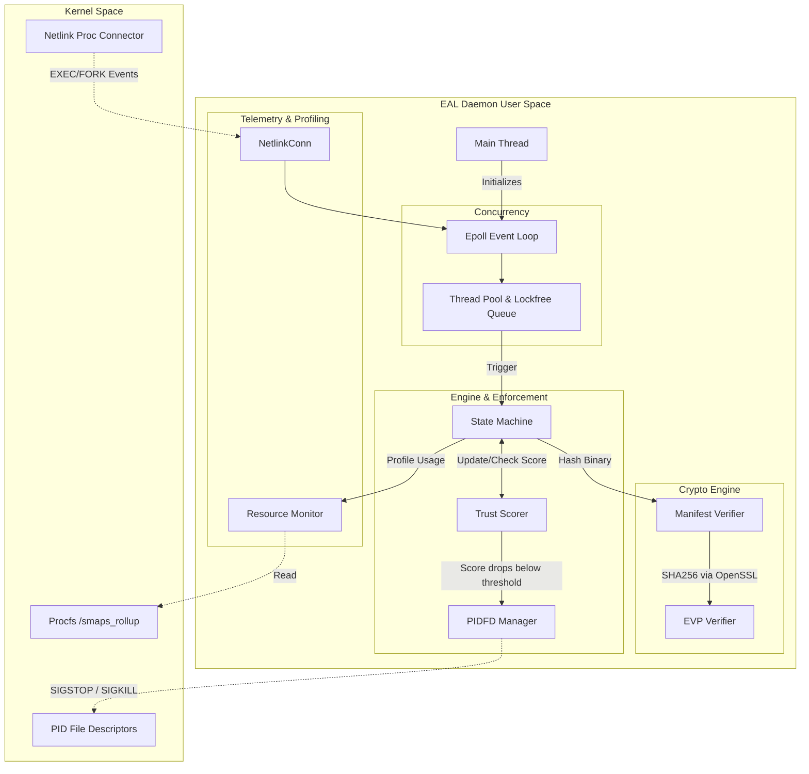

# Execution Authorization Layer (EAL)


**Execution Authorization Layer (EAL)** is a high-performance, Linux-native security daemon (`eal_daemon`) designed to monitor, evaluate, and control process execution in real-time. By leveraging advanced Linux kernel features and cryptographic verification, EAL implements a zero-trust architecture at the operating system level. 

It dynamically tracks process behaviors, calculates Trust Scores, and enforces strict policies (such as freezing or eradicating processes) completely immune to PID-reuse race conditions.

## 🚀 Key Features

* **Real-time Process Telemetry:** Utilizes the Linux Netlink Connector (`proc_cn_mcast_op`) to instantly catch `EXEC` and `FORK` events directly from the kernel.
* **Cryptographic Verification:** Validates process binaries using OpenSSL-backed SHA-256 hashing (`EVP_Digest`) against a predefined JSON whitelist manifest.
* **Dynamic Trust Scoring:** Processes are assigned a starting score (e.g., 10,000) and transition through states (`TRUSTED` ➔ `OBSERVED` ➔ `RESTRICTED` ➔ `QUARANTINED`) based on behavior anomalies (e.g., rapid memory allocation).
* **Race-Free Enforcement:** Uses the modern Linux `pidfd` API to safely issue signals (`SIGSTOP`, `SIGKILL`) to rogue processes without the risk of PID recycling.
* **High-Performance Concurrency:** Built on an asynchronous event loop (`epoll`), thread pooling, and lock-free queues to handle massive system loads with minimal overhead.
* **Resource Profiling:** Actively monitors CPU ticks and Proportional Set Size (PSS) memory usage to detect memory leaks and CPU hogs.

---

## 🏗️ Architecture Diagram

The system operates across several modular subsystems. Below is the internal flow of the `eal_daemon` (as referenced in `all_code.txt`):



---

## 📂 Project Structure

Based on the build dependencies in `all_code.txt`, the project is structured as follows:

```text
eal/
├── CMakeLists.txt              # CMake configuration
├── /etc/eal/
│   └── default_manifest.json   # Trusted binary hash whitelist
├── include/                    # Header files
│   ├── concurrency/
│   ├── crypto/
│   ├── enforcement/
│   ├── engine/
│   ├── profiler/
│   └── telemetry/
└── src/                        # Source implementation
    ├── main.cpp                # Daemon entry point
    ├── concurrency/
    │   ├── epoll_loop.cpp      # I/O multiplexer
    │   └── thread_pool.cpp     # Async worker pool
    ├── crypto/
    │   ├── evp_verifier.cpp    # OpenSSL EVP hashing
    │   └── manifest_verifier.cpp # JSON whitelist loading
    ├── enforcement/
    │   ├── pidfd_manager.cpp   # Race-free signalling
    │   └── state_machine.cpp   # State transitions
    ├── engine/
    │   └── trust_scorer.cpp    # Anomaly scoring logic
    ├── profiler/
    │   └── resource_monitor.cpp # Memory & CPU polling
    └── telemetry/
        └── netlink_conn.cpp    # Kernel process events
```

---

## 🛠️ Prerequisites

To build and run EAL, you must have the following installed on your system:

* **OS:** Linux (Kernel 5.3+ recommended for robust `pidfd` support)
* **Compiler:** GCC or Clang with **C++17/C++20** support
* **Build System:** CMake 3.10+ and Make/Ninja
* **Libraries:** 
  * OpenSSL (`libcrypto`, `libssl`)
  * pthread

---

## ⚙️ Building the Project

The build system utilizes CMake. Follow these steps to compile the daemon:

```bash
# 1. Clone the repository and navigate to the root directory
cd eal

# 2. Generate build files
cmake -S . -B build -DCMAKE_BUILD_TYPE=Release

# 3. Compile the daemon
cmake --build build -j $(nproc)

# 4. Optional: Install to system paths
sudo cmake --install build
```
This will produce the main executable: `./build/eal_daemon`.

---

## 🛡️ Usage and Configuration

Because EAL interfaces directly with the Netlink Proc Connector and `pidfd` APIs, it **must be run as root**.

```bash
sudo ./build/eal_daemon
```

### Manifest Whitelist
Upon startup, the daemon looks for its default manifest at:
`/etc/eal/default_manifest.json`

Ensure this file contains the authorized SHA-256 hashes of the binaries allowed to run with `TRUSTED` status.

### Expected Output
When running successfully, you will see telemetry and enforcement logs:
```
[*] Execution Authorization Layer (EAL) Starting...
[*] Thread pool initialized with <N> workers.
[*] Loaded <N> whitelisted SHA-256 hashes into memory.
[*] Epoll I/O multiplexer armed. Entering fast-path event loop...
[+] EAL Daemon is active and enforcing policies. (Press Ctrl+C to stop)

[EVENT] EXEC - PID: 1234 | SHA-256: <hash>
[STATE] PID 1234 Registered | Hash: <hash> | Score: 10000 | State: TRUSTED
[ANOMALY] PID 1234 rapidly allocated 500 MB of memory.
[SCORE] PID 1234 penalized by 5000. Score dropped from 10000 to 5000
[STATE] PID 1234 transitioned: TRUSTED -> OBSERVED
[ENFORCE] Freezing PID 1234 (SIGSTOP via PIDFD)
[ENFORCE] Eradicating PID 1234 (SIGKILL via PIDFD)
```

## 📜 License
*Specify your license here (e.g., MIT, GPLv3).*
